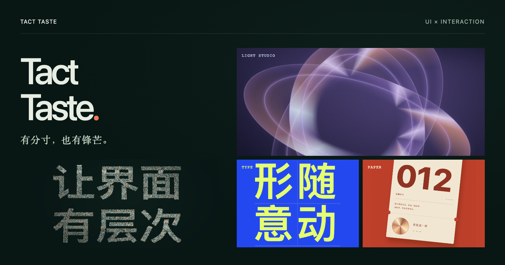
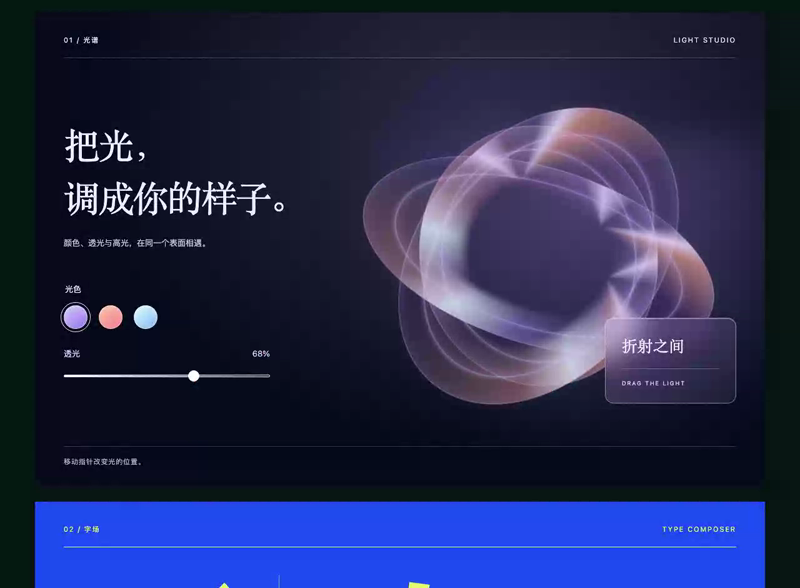
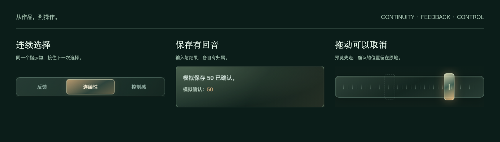

[](https://tech.wenmq.cn/tact-taste/showreel.html)

# Tact Taste

**Taste in the image. Tact in the interaction.**

[中文](README.md) · [Live site](https://tech.wenmq.cn/tact-taste/) · [32-second film](https://tech.wenmq.cn/tact-taste/showreel.html) · [Download v0.1.0](https://github.com/hellowmq/tact-taste/releases/tag/v0.1.0) · [Install](docs/INSTALL.md) · [Examples](docs/EXAMPLES.md) · [MIT](LICENSE)

A **UI and interaction design skill for coding assistants**. Refine layout, typography, palette, and material together with selection, waiting, cancellation, and recovery.

Give the assistant your project and goal. It inspects the real interface, implements useful improvements, and verifies the affected flows. Keep the product’s identity and business rules; follow its existing framework and host.

## A visible point of view

- **Light Studio** — color, transmission, and highlights meet on a glass surface.
- **Type Composer** — the same four characters move between bold, spacious, and offset compositions.
- **Paper Walk** — texture, printed type, and foil; choose a ticket, collect it, or change your mind.

The cover also includes paired particle typography: text **1 / 2 → 2 / 3**, sharing the same second view at handoff.

**[Watch the 32-second showreel ↗](https://tech.wenmq.cn/tact-taste/showreel.html)** — particle typography, color and layout, followed by collection reversal, continuous selection, and drag cancellation. Actual example interactions with an original score. [Download MP4](https://github.com/hellowmq/tact-taste/releases/download/v0.1.0/tact-taste-showreel-v0.1.0.mp4) · [Production source](showreel/README.md).

<details>
<summary>Expand the 14-second interaction excerpt</summary>

<picture>
  <source media="(prefers-reduced-motion: no-preference)" srcset="docs/media/interactions.gif">
  
</picture>

A compressed excerpt of the running interface. Reduced motion displays a still; collapse to stop watching. See the [example guide](docs/EXAMPLES.md) for the full controls and acceptance steps.

</details>

## Craft reaches the controls

<picture>
  <source media="(max-width: 600px)" srcset="docs/media/behavior-mobile.png">
  
</picture>

Let the same object receive the next choice. Give input, pending work, and results their own meaning. Make previews cancellable and failure recoverable. Continuous alpha, gradients, and highlights express state alongside keyboard access, focus, and reduced motion.

These are opinionated design judgments. A showcase can be bold; a frequent action needs the right proportion. Verify the result in your own product.

## Use it in your project

Download and verify the ZIP from the [Release](https://github.com/hellowmq/tact-taste/releases/tag/v0.1.0), extract it, and enter `tact-taste`. Python 3.9+ is required for installation:

```sh
python3 scripts/install.py --to "$HOME/.codex/skills/tact-taste"
```

Start a new session and select the skill, or ask the assistant to read the installed `SKILL.md`:

```text
Use $tact-taste to improve this page’s UI and interactions.
Preserve brand colors and business rules. Refine typography, material,
and state changes. Implement useful improvements, run the affected flows,
and report the evidence.
```

The installer copies skill files, downloads nothing, and refuses to overwrite existing work. See [installation and migration](docs/INSTALL.md) for Claude Code, manual use, and the legacy `interaction-master` skill.

## Explore further

- [UI design judgments](references/ui-design.md) — hierarchy, typography, color, material, and continuous alpha.
- [Examples and acceptance](docs/EXAMPLES.md) — local preview, controls, particle typography, and the theme study.
- [Preservation review](docs/PRESERVATION.md) — core rules, twelve motion cards, and fifteen engineering lessons.
- [Development and contributions](docs/DEVELOPMENT.md) — project structure, checks, and packaging; [changelog](CHANGELOG.md).

Original project text and code use [MIT](LICENSE). Preview images and animation come from our own implementation. [Sources and licensing](docs/SOURCES.md) record the boundaries; [visual references](docs/VISUAL-REFERENCES.md) explain the observations and decisions. Saving and collection are local simulations. The skill is in English; the example interface and detailed guides are primarily in Chinese.
